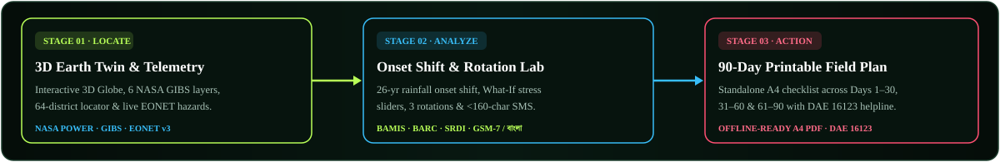

[;All+64+Districts+of+Bangladesh+%C2%B7+Developed+by+Rezwan+Hossain+Prince+%26+Team+EARTH.exe)](https://github.com/rzprince/NASA-SPACE-APPS-Challenge-2026)

[](https://github.com/rzprince/NASA-SPACE-APPS-Challenge-2026) [](https://github.com/rzprince) [](https://github.com/rzprince) [](https://github.com/rzprince/NASA-SPACE-APPS-Challenge-2026) [](https://github.com/rzprince/NASA-SPACE-APPS-Challenge-2026) [](https://github.com/rzprince/NASA-SPACE-APPS-Challenge-2026/blob/main/LICENSE)

## Overview

**BoponX (`বপনএক্স: মহাকাশ থেকে মাটিতে`)** is an agricultural decision-support platform created by **Team EARTH.exe** for the **2026 NASA International Space Apps Challenge** (*Challenge: Field Shift — Adapting Farms with NASA Data*).

Shifting monsoon onset dates, erratic dry spells, heat stress, and continuous monoculture cropping threaten farm livelihoods across climate-vulnerable deltas. **BoponX** bridges the gap between orbital Earth observations and field-level action by fusing **6 live NASA satellite systems** with **6 national agricultural authorities across all 64 districts and 8 divisions of Bangladesh**, complete with a built-in **BoponX AI-CHATBOT Assistant (Voice + Text in English & বাংলা)** for farmers, extension officers, and decision-makers.



<div align="center">
  
  <br/>
  <a href="https://github.com/rzprince/NASA-SPACE-APPS-Challenge-2026">
    
  </a>
  <br/>
  
  
  
</div>

## Core Experience & BoponX AI-CHATBOT Assistant

| Stage / Module | Component | What It Delivers |
| :--- | :--- | :--- |
| **01 · Location** | **3D Earth Twin & Telemetry Hub** | Interactive 3D Globe and 2D field map with 6 live [NASA GIBS / Worldview](https://worldview.earthdata.nasa.gov/) satellite layers, 64-district Bangladesh quick-locator, agroclimatic water balance via [NASA POWER](https://power.larc.nasa.gov/docs/services/api/temporal/daily/), and live natural hazard tracking via [NASA EONET v3](https://eonet.gsfc.nasa.gov/docs/v3). |
| **02 · Analysis** | **Planting-Window & Rotation Lab** | 26-year (`2001–2026`) usable-rain onset shift detection (Mann-Whitney U, Hodges-Lehmann shift, 95% CI, Sen slope), `HTTP 422` soil-chemistry guardrail, `<160`-char mobile SMS advisories (`EN` & `বাংলা`), interactive climate stress-test sliders, and 3-season rotation comparisons grounded in [BAMIS](https://www.bamis.gov.bd/), [BARC](https://barc.gov.bd/), and [SRDI](https://srdi.gov.bd/). |
| **03 · 90-Day Plan** | **Printable Field Action Card** | A standalone, offline-ready A4 90-day field plan organized into three 30-day operational phases (`Days 1–30`, `Days 31–60`, `Days 61–90`) with verifiable source attribution and [DAE (`16123`)](https://dae.gov.bd/) extension sign-off. |
| **AI Assistant** | **BoponX AI-CHATBOT Assistant (`EN` + `বাংলা`)** | Tapping the floating circular **BoponX Orbital Logo** anywhere in the dashboard opens the bilingual voice-and-text **BoponX AI-CHATBOT Assistant** (`/api/v1/assistant/chat`), which answers live field telemetry questions, switches satellite layers, selects any of the 64 Bangladesh districts, updates crop/water/priority inputs, and generates 90-day field plans on command. |

## Complete NASA & Local Bangladesh Data Architecture


### 1. NASA Datasets & APIs Utilized (6 Core Systems)

| NASA System | Verified Endpoint / Portal Link | Parameters & Spatial Resolution | Specific Contribution in BoponX |
| :--- | :--- | :--- | :--- |
| **1. NASA POWER Daily Agroclimatology API** | [power.larc.nasa.gov/api/temporal/daily/point](https://power.larc.nasa.gov/api/temporal/daily/point) · [Docs](https://power.larc.nasa.gov/docs/services/api/temporal/daily/) | `PRECTOTCORR`, `T2M`, `T2M_MAX`, `T2M_MIN`, `T2MDEW`, `RH2M`, `WS2M`, `ALLSKY_SFC_SW_DWN`, `GWETTOP` (`0–5 cm`), `GWETROOT` (`0–100 cm`) · `0.5° × 0.625°` MERRA-2 | Powers 26-year (`2001–2026`) usable-rain onset shift statistics across **40 unique MERRA-2 grid cells** covering all 64 districts, plus live 14-day FAO-56 `ET₀`, net water balance (`P − ET₀`), `GDD`, `VPD`, and heat/frost/fog-blight diagnostics. |
| **2. NASA POWER Monthly Climatology API** | [power.larc.nasa.gov/api/temporal/climatology/point](https://power.larc.nasa.gov/api/temporal/climatology/point) · [Docs](https://power.larc.nasa.gov/docs/services/api/temporal/climatology/) | 20-year (`2001–2020`) monthly normals for `T2M`, `PRECTOTCORR`, `ET₀`, `GWETTOP`, `GWETROOT` · `0.5° × 0.625°` | Establishes the historical seasonal baseline for Stage 01 rainfall/temperature anomaly detection and scales the 90-day outlook across `Days 1–30`, `31–60`, and `61–90`. |
| **3. NASA EONET v3 Natural Event Tracker API** | [eonet.gsfc.nasa.gov/api/v3/events](https://eonet.gsfc.nasa.gov/api/v3/events) · [Docs](https://eonet.gsfc.nasa.gov/docs/v3) | Live open events (`floods`, `severeStorms`, `drought`, `landslides`, `wildfires`) within `1,200 km` radius | Real-time Bay of Bengal cyclone & flood proximity engine (`affects_field_operations = True`); automatically injects emergency bund/drainage tasks and [DAE (`16123`)](https://dae.gov.bd/) alerts into Phase 1 of the 90-day plan. |
| **4. NASA GIBS / Worldview Satellite Imagery (WMTS/WMS)** | [worldview.earthdata.nasa.gov](https://worldview.earthdata.nasa.gov/) · [GIBS Docs](https://nasa-gibs.github.io/gibs-api-docs/) | 6 Layers: `MODIS_Terra_CorrectedReflectance_TrueColor` (`250 m`), `MODIS_Terra_NDVI_8Day` (`250 m`), `MODIS_Terra_Land_Surface_Temp_Day` (`1 km`), `IMERG_Precipitation_Rate` (`10 km`), `SMAP_L2_Passive_Day_Soil_Moisture` (`9 km`), `SRTM_Color_Index` (`30–90 m` DEM) | Drives the interactive 3D Orbital Earth Twin and 2D Field Map with multi-date time-scrubber comparison for canopy greenness, bare-field detection, surface heat stress, and flood-basin elevation. |
| **5. NASA GPM IMERG V07 Final & Early V07B** | [gpm.nasa.gov/data/imerg](https://gpm.nasa.gov/data/imerg) · [GPM_3IMERGDF V07](https://www.earthdata.nasa.gov/data/catalog/ges-disc-gpm-3imergdf-07) · [GPM_3IMERGDE V07B](https://www.earthdata.nasa.gov/data/catalog/ges-disc-gpm-3imergde-07) | `0.1° × 0.1°` (`~10 km`) daily (`mm/day`) & half-hourly (`mm/hr`) precipitation via NASA GES DISC OPeNDAP + GIBS | Captures localized convective storm cells and powers the non-imputing cross-validation engine (`/api/v1/validation/imerg`) computing `Mean Bias`, `MAE`, `RMSE`, and `Pearson r` against NASA POWER `PRECTOTCORR`. |
| **6. NASA SMAP L3 Radiometer Soil Moisture (`SPL3SMP_E V6`)** | [nsidc.org/data/spl3smp_e/versions/6](https://nsidc.org/data/spl3smp_e/versions/6) | L-band (`1.41 GHz`) passive microwave top `0–5 cm` volumetric soil moisture (`cm³/cm³`) · `9 km` EASE-Grid 2.0 | Monitors surface seedbed workability (*"jo"* condition) while enforcing the Stage 02 `HTTP 422 SOIL_TEST_REQUIRED` scientific boundary (since satellite microwave cannot sense soil `pH`, `EC`, or `NPK`). |

### 2. Local Bangladesh Datasets, Authorities & BoponX Internal APIs (6 Core Systems)

| Local Authority / API System | Official Portal / Endpoint Link | Coverage & Scope | Specific Contribution in BoponX |
| :--- | :--- | :--- | :--- |
| **1. BAMIS (Bangladesh Agro-Meteorological Information Portal)** | [bamis.gov.bd](https://www.bamis.gov.bd/) | 14 Regional Agro-Met Hubs · 9 Staple & Cash Crops (`Aman`, `Boro`, `Aus`, `Mustard`, `Lentil`, `Wheat`, `Maize`, `Mungbean`, `Jute`) | Aligns 26-year NASA POWER usable-rain onset shifts against official regional sowing/transplanting windows across all 64 districts. |
| **2. BARC (Bangladesh Agricultural Research Council)** | [barc.gov.bd](https://barc.gov.bd/) · [FRG-2024 Guide (PDF)](https://apps.barc.gov.bd/fertilizer_recommendation/FRG%20English%2030.10.2024.pdf) · [Crop Zoning](https://apps.barc.gov.bd/cropzoning/) | 30 Agro-Ecological Zones (AEZ) · Fertilizer Recommendation Guide (`FRG-2024`) | Supplies AEZ soil fertility baselines, organic matter (`OM%`) targets, legume biological nitrogen fixation (`BNF`) credits (`+30–50 kg N/ha`), and split `N-P-K-S-Zn-B` dosage rules unlocked in Stage 02. |
| **3. SRDI (Soil Resource Development Institute)** | [srdi.gov.bd](https://srdi.gov.bd/) | *Upazila Thana Nirdeshika* (`1:50,000` soil series) & *Saline Soils of Bangladesh* | Provides district/AEZ soil pH ranges, drainage classes, soil texture, and coastal electrical conductivity (`EC dS/m`) salinity thresholds across southern belts (`AEZ 13`, `18`, `23`). |
| **4. BARI & BRRI (Agricultural & Rice Research Institutes)** | [bari.gov.bd](https://bari.gov.bd/) · [brri.gov.bd](https://brri.gov.bd/) | Cultivar stress tolerance & FAO-56 crop water coefficients (`Kc`) | Defines flowering heat-sterility (`≥35°C`), cold injury (`≤12°C`), and salinity limits, plus stage-specific `Kc_ini`, `Kc_mid`, and `Kc_end` curves (`ETc = ET₀ × Kc`). |
| **5. DAE (Department of Agricultural Extension — `16123`)** | [dae.gov.bd](https://dae.gov.bd/) | National Toll-Free Krishi Call Center (`16123`) & Upazila SAAO Network | Embeds extension officer verification and emergency helpline routing directly into every EONET cyclone/flood alert, `<160`-char SMS advisory, and printable A4 90-day plan. |
| **6. BoponX FastAPI v3.1, AI-CHATBOT & Nominatim APIs** | [github.com/rzprince/NASA-SPACE-APPS-Challenge-2026](https://github.com/rzprince/NASA-SPACE-APPS-Challenge-2026) · [nominatim.openstreetmap.org](https://nominatim.openstreetmap.org/) | `/api/v1/assistant/chat`, `/api/v1/bangladesh/resolve`, `/api/v1/context`, `/api/v1/advisory`, `/api/v1/soil/evidence`, `/api/v1/validation/imerg`, `/api/v1/provenance`, `/api/v1/plans/preview` | Deterministic 64-district coordinate resolution, bilingual AI-CHATBOT command routing, non-imputing IMERG vs. POWER validation, and zero-fabrication governance (`HTTP 503` on upstream outage, `HTTP 422` soil gate). |

## Quick Start — How to Run (Windows, macOS & Linux)

### Prerequisites
- **Python** `3.10+`
- **Node.js** `18+` and **npm**

### Option A: Run on Windows (PowerShell)

**1. Terminal 1 — Clone the repository and start the Backend + AI-CHATBOT API (`http://127.0.0.1:8000`):**
```powershell
git clone https://github.com/rzprince/NASA-SPACE-APPS-Challenge-2026.git
cd NASA-SPACE-APPS-Challenge-2026

python -m venv .venv
.\.venv\Scripts\python.exe -m pip install --upgrade pip
.\.venv\Scripts\python.exe -m pip install -r .\backend\requirements.txt -r .\backend\requirements-dev.txt

Remove-Item Env:OFFLINE -ErrorAction SilentlyContinue
Remove-Item Env:BOPONX_OFFLINE -ErrorAction SilentlyContinue
.\.venv\Scripts\python.exe -m uvicorn backend.app.main:app --reload --host 127.0.0.1 --port 8000
```

**2. Terminal 2 — Open a second PowerShell window and start the Frontend (`http://localhost:5173`):**
```powershell
cd NASA-SPACE-APPS-Challenge-2026\frontend
npm install --no-audit --no-fund
if (Test-Path ".\node_modules\esbuild\install.js") { node .\node_modules\esbuild\install.js }
icacls ".\node_modules" /grant "${env:USERNAME}:(OI)(CI)F" /T /Q | Out-Null
attrib -r ".\node_modules\*.*" /s
npm run dev
```

*(Alternatively, you can use the included PowerShell helper script: `.\scripts\run.ps1 setup`, `.\scripts\run.ps1 backend`, and `.\scripts\run.ps1 frontend`.)*

### Option B: Run on macOS / Linux (Terminal)

**1. Terminal 1 — Clone the repository and start the Backend + AI-CHATBOT API (`http://127.0.0.1:8000`):**
```bash
git clone https://github.com/rzprince/NASA-SPACE-APPS-Challenge-2026.git
cd NASA-SPACE-APPS-Challenge-2026

python3 -m venv .venv
source .venv/bin/activate
python -m pip install --upgrade pip
python -m pip install -r backend/requirements.txt -r backend/requirements-dev.txt

unset OFFLINE BOPONX_OFFLINE
python -m uvicorn backend.app.main:app --reload --host 127.0.0.1 --port 8000
```

**2. Terminal 2 — Open a second Terminal tab and start the Frontend (`http://localhost:5173`):**
```bash
cd NASA-SPACE-APPS-Challenge-2026/frontend
npm install
npm run dev
```

### Run Automated Verification Suite (133 Backend & AI-CHATBOT Tests)
```bash
pytest -q backend/tests
```

## 240s and 30s Video YouTube Links

- **1 · Prescreening 240 seconds:** https://www.youtube.com/watch?v=RCZ4_AXb-3k
- **2 · Local Judging 240 seconds:**
- **3 · Global Judging 30 seconds:**


## Team & Authorship

- **Developed by:** [Rezwan Hossain Prince](https://github.com/rzprince) (Team Leader, Lead Developer, System Architect, Video Editor) and
- **Team EARTH.exe:**<br>
Shafayet Hossain (AI/ML Developer)<br>
Md. Khairul Islam Joy (Project Manager)<br>
Tulip Mondal Gourab (Information Researcher)<br>
Alana Mondal Roshni (Creative Designer)<br>
Iftekar Azad Ether (Data Researcher)<br>
- **Competition:** 2026 NASA International Space Apps Challenge
- **License:** Released under the [Apache License 2.0](https://github.com/rzprince/NASA-SPACE-APPS-Challenge-2026/blob/main/LICENSE)


